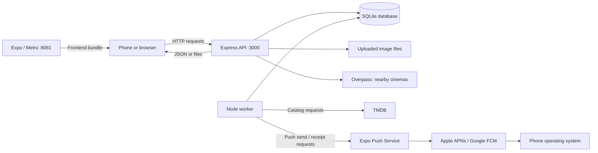

> Repository transfer and existing-data upgrade: see [TRANSFER.md](TRANSFER.md).

# WhatNext: startup, data flow, background jobs and architecture defense

This walkthrough describes the standalone backend and its integration with the separate Expo frontend. Backend paths are relative to this repository. Frontend App.tsx, contexts, screens and services live in aplicaciones-moviles-2026, not in this repository.

## 1. The running pieces

| Piece | Entry point | Executes where? | Responsibility |
| --- | --- | --- | --- |
| Expo/Metro development server | `expo start` | Development computer, normally port 8081 | Transforms/bundles the frontend and supplies it to the phone/browser. |
| Frontend | `index.ts` → `App.tsx` → providers → `src/Navigator.tsx` | Phone or browser | Screens, interaction, local state, permissions, HTTP requests. |
| API | `src/index.ts` | Computer/server, normally port 3000 | Validates requests and identity, executes business rules, reads/writes the database, returns JSON/files. |
| Worker | `src/worker.ts` | Computer/server, a separate Node process | Schedules catalog sync and release push delivery. No HTTP listener is required for the worker. |
| Database | `prisma/local.db` locally | Disk on computer/server | Persistent SQLite tables. SQLite is embedded; it is not another listening server. |
| Uploaded images | `uploads/`, or `UPLOAD_DIR` | Disk on computer/server | Persistent image files; database rows hold their paths and ownership. |
| Prisma Studio (optional) | `prisma studio` | Computer, normally port 5555 | Administrative database viewer/editor. It is not the API or app. |
| External services | TMDB, Overpass, Expo Push, Apple/Google Wallet | Their servers | Catalog source, cinema lookup, push transport, Wallet issuance. |



API and worker are two processes of the same backend, sharing the same schema and database. They do not share JavaScript memory. This is a small modular backend, not a set of microservices. The phone never opens the SQLite file or imports backend modules.

## 2. Compilation, installation and execution are different

**Installation:** `npm ci` reads the lockfile and installs dependencies. Do this separately for the root package and backend package. Installing a package does not start the API or import movie data.

**Frontend development:** Expo uses Metro to transform TypeScript/TSX and bundle modules/assets. The app starts at root `index.ts`, which calls `registerRootComponent(App)`. Expo Go provides the installed native runtime; a development build provides our own native runtime. Scanning the QR code loads the frontend project into that runtime. It does not run the backend on the phone. See [Metro documentation](https://docs.expo.dev/guides/customizing-metro/).

**Frontend type checking:** root `npm run typecheck` runs `tsc --noEmit`: checks types without generating application output. TypeScript types do not validate incoming network JSON at runtime.

**Backend development:** `npm run dev` runs `tsx watch src/index.ts`. `tsx` transforms TypeScript for execution; it is not a substitute for `tsc --noEmit`. Watch restarts the API after relevant source edits. The worker command uses plain `tsx`, without watch; restart it after worker/schedule changes.

**Backend production build:** `npm run build` invokes `tsc -p tsconfig.build.json`. Backend `src/` is compiled into JavaScript under `dist/`. `npm start` executes `node dist/index.js`; `worker:start` executes `node dist/worker.js`. Building generates code, but does not start processes or create movie data. Frontend production needs an app/web build separately; `expo export` checks/generates frontend bundles and assets, not a signed native installation by itself.

**Database generation versus migration:** `prisma generate` creates a schema-specific client and TypeScript types in dependencies. `prisma migrate deploy` applies versioned SQL migrations to actual tables. Neither downloads TMDB movies. `db:setup` coordinates generation/setup/migrations; `catalog:sync` imports catalog data separately. `db:seed` initializes missing reward, achievement and rank definitions without overwriting custom values or deleting accounts.

## 3. What imports and startup actually do

An `import` loads a module and evaluates its top-level statements once per process. Function definitions become available; their bodies do not all run immediately. They run when called by startup, a request handler, another function, a React effect, or the worker scheduler.

The API startup sequence in `src/index.ts`:

1. Import `config.ts`. Its top-level code loads backend `.env` and resolves the SQLite URL to an absolute path.
2. Import the Prisma client and route registration functions. `prisma.ts` creates the client object; the database connection is established as queries need it.
3. `require.main === module` detects direct execution of this entry point. Tests can import `createApp()` without automatically starting a fixed-port server.
4. `createApp()` checks required configuration, creates Express, installs security headers, browser CORS, request limits and JSON-body parsing.
5. Calls such as `movieRoutes(app)` register handlers. Registering `app.get('/api/movies', callback)` does not query movies yet; it tells Express which callback to execute later.
6. `.listen(...)` binds port 3000 on network interfaces. The process waits for requests; `API WhatNext lista` is a success message, not a hang.
7. Requests trigger only the matching handler and its middleware. Errors flow to the final error handler. Unknown paths return 404.

The worker independently imports configuration/Prisma, validates the cron expression, registers timers, performs an initial release-push check, and stays running. It does not perform a catalog sync immediately on startup; that happens at the scheduled time or through the one-shot sync command.

## 4. How the phone boots and loads screens

`App.tsx` loads fonts, configures foreground notification behavior, and renders providers around the navigator. Providers expose shared React state; they are not databases or backend processes.

- `AuthProvider`: loads the stored token, calls `/api/auth/me`, and restores a valid account. Tokens are stored in SecureStore on native and localStorage on web. A token is kept in memory for request headers.
- `RemindersProvider`: once an account is available, loads its subscriptions and attempts device push registration when supported. Refreshes on resume/focus.
- `GamificationProvider`: holds fetched achievements, reward balances and points history. Its functions fetch them when the relevant screen asks.
- `MoviesProvider`: holds the API's home/catalog response. Home calls `fetchMovies()` on screen focus; the provider does not calculate rankings.
- `RootNavigator`: selects tabs/screens and receives notification taps. The intro/font-loading branch controls when the normal navigation UI appears.

`useOnFocus()` wraps React Navigation's focus effect. It runs a screen's loading callback when that screen becomes visible or its dependencies change. `useEffect()` runs after a component renders, subject to its dependency list. Neither is a cron scheduler.

Frontend state starts empty/loading. An HTTP response updates `useState`; React renders again with the returned values. Stopping/restarting the app discards in-memory state, but the next API request reloads saved database data. The auth token is a separate persisted credential.

## 5. A complete movie-loading request

Example: open Home.

```text
Home's focus callback
→ MoviesProvider.fetchMovies()
→ frontend getMovieHome() in src/services/movies.ts
→ request('/movies/home') in src/services/http.ts
→ GET http://<server>:3000/api/movies/home
→ backend movieRoutes() handler
→ optionalAuth() checks any supplied session
→ backend getMovieHome()
→ getMovieCatalog() → Prisma movie queries
→ getMovieStats() + getFriendsRatings()
→ toMovieDTO() prepares the response
→ res.json({ list, featured, hero, trending })
→ frontend fetch parses JSON
→ setMovies({ ...data, isFetching: false })
→ Home renders the returned sections
```

The frontend function named `getMovieHome()` is an HTTP wrapper. The backend function with the same name queries/calculates data. They execute in different processes; the connection is the URL and JSON contract, not a TypeScript import across applications.

`request()` builds the API URL, attaches `Authorization: Bearer ...` if logged in, JSON-encodes request bodies, enforces a timeout, parses JSON, handles expired sessions/errors and resolves relative uploaded-image paths. `resolveApiUrl()` uses the explicit public API setting if supplied, otherwise the current Expo/browser hostname on port 3000 during development. This prevents yesterday's Wi-Fi address from being hardcoded. Production must have an explicit reachable API URL.

`/api` is only a URL prefix. Each full path is registered in its route file. There is no `/api` source directory and no handler for `/api` alone.

The detail screen similarly calls movie detail, recommendations and reviews with `Promise.all`, then stores the results in screen state. These are independent HTTP requests, not one database query.

## 6. Where calculations happen and why

| Result | Backend implementation | Input / rule | Frontend's role |
| --- | --- | --- | --- |
| Community rating | `getMovieStats()` | Average saved non-null review ratings, rounded to one decimal. No ratings gives null. | Render stars/text. |
| Rating/comment counts | `getMovieStats()` | Count ratings separately from all reviews. | Show returned counts. |
| Trending | `getMovieHome()` | Reviews in the last 30 days, excluding future timestamps; sort by activity then rating/title/ID. | Render returned order. |
| Hero | `getMovieHome()` | Featured movies, otherwise up to four rated/catalog movies. | Carousel presentation. |
| Recommendations | `getMovieRecommendations()` | Same-genre candidates, server rating ordering, up to six. | Render returned cards. |
| Friends' average | `getFriendsRatings()` | Accepted friendships plus saved ratings. | Display personalized result. |
| Release-list rating | TMDB import and `getMovieReleases()` | TMDB score normalized from ten to five, distinct from community rating. | Format label. |
| Rank | `calculateRank()` called by profile route | Current profile review count; thresholds 5, 25, 50, 100. | Display badge/progress. |
| Achievement awards | `getAchievements()` | Saved reviews, likes, genres, ratings and photos; permanent one-time award. | Display badges and progress. |
| Available points | `pointsSummary()` | Sum permanent credits/debits/refunds. | Display returned balance. |
| Reward eligibility/cost | Redemption route + points helpers | Server reward definitions and verified available balance. | Offer button; server rechecks regardless of UI. |
| Cinema distances/order | `distanceKm()` / `getNearbyCinemas()` | Coordinates, radius, validated Overpass results and cache. | Request location permission; format distance/open directions. |
| Reminder time | `releaseReminderTime()` / worker | Movie release date at 10:00 Buenos Aires. | Display time and saved state. |

Computed results are generally produced on request rather than running every calculation at startup. Permanent achievement awards/ledger entries are saved; aggregate ratings and rank are derived from current data. Presentation arithmetic remains on the frontend, e.g. converting progress to a percentage or showing '15 more points needed'. It never authorizes spending.

JSON is data, not executable business logic. A response like `{ "availablePoints": 15 }` tells React what to display. The phone does not receive the server's `pointsSummary()` implementation.

## 7. Review → points → frontend update

When the user submits a review, the app sends text/rating/photo reference to `POST /api/movies/:id/reviews`. The backend takes the author from the authenticated session, not from a caller-provided user ID. It validates the movie and input, checks image ownership, and uses a transaction to save the review and reconcile awards.

`getAchievements()` counts qualifying activity. A unique `(userId, achievementId)` award and unique points-entry key ensure a repeated fetch or delete/recreate cycle cannot earn that achievement twice. Changing/deleting a review later does not revoke an already saved achievement award. Rank is separate and still follows current profile review count.

For five rated reviews, with no photo/genre/like bonuses, earned points are 10 for the first review + 20 for five reviews + 15 for five ratings = 45. A 30-point redemption makes the available balance 15. Canceling it restores 30, bringing balance back to 45; earned lifetime achievement points remain 45 throughout.

The response to a review returns the saved review. MovieDetail then reloads its data. The Logros screen loads achievements/rewards/history on focus. There is no WebSocket or automatic database subscription: another device's changes, a daily TMDB sync or a staff action appear after the frontend refetches the relevant endpoint.

## 8. Why canjes need transactions and an append-only history

`POST /api/rewards/redeem` looks up the reward by ID on the server. The client does not set its price. `withUserPoints()` acquires SQLite's writer lock before reading the balance. The backend checks funds, creates the redemption/code and records a negative point entry in one transaction. A failure rolls everything back. With SQLite, writes are serialized at database level, not by a magical distributed per-user lock.

`cancelRedemption()` / `refundRedemption()` share `reverseRedemption()`. It checks ownership where required, verifies the original debit and stored cost, checks whether a refund already exists, changes the unused voucher's state, and records one positive refund entry. A retry can return the existing owner cancellation without crediting again. Staff use performs an atomic conditional update; a use/cancellation race cannot both succeed.

Canceled canjes disappear from the active frontend list, but their inactive record and debit/credit entries remain for audit. Deleting the evidence would make repeat/refund reconciliation harder. The code, not a picture of a Wallet pass, is checked against the current server state.

## 9. How new movies enter the database

The scheduled `syncCatalog()` and the manual sync command use the same function:

1. Acquire a database job lease so another importer does not overlap.
2. Create a running `SyncRun` record.
3. Fetch popular, now-playing and upcoming theatrical lists for Argentina. Pagination is bounded by `TMDB_SYNC_MAX_PAGES` (default 5); upcoming discovery covers the next 120 days.
4. Combine those TMDB IDs with IDs of previously saved TMDB movies.
5. For each ID, `importMovieFromTmdb()` fetches details and prepares metadata, genres, images, credits, videos, providers and release date.
6. `prisma.movie.upsert({ where: { tmdbId }, create: ..., update: ... })`: create if the ID is new, otherwise update metadata while preserving local movie ID, reviews, featured/hidden state.
7. After all imports succeed, replace `CatalogEntry` memberships and mark the run successful in a transaction.
8. Record failures and release the lease.

This discovers movies in the fetched lists, not all of TMDB. A failed import keeps previous list memberships; movie metadata already written earlier in the run may have updated. Manual movies without a TMDB ID are not automatically refreshed.

`GET /api/movies` and release endpoints only read saved data. This keeps browsing independent of TMDB availability and keeps its key server-side.

## 10. Push notifications from subscription to display

A reminder, device registration and delivery record are different things:

| Record | Meaning |
| --- | --- |
| `ReleaseReminder` | This account wants an alert for this movie. |
| `PushDevice` | This app installation has a push token, platform and active login-session association. |
| `PushDelivery` | One planned/attempted delivery for an account/device/movie/release-date combination. |

### Registration

1. The user signs in on a physical phone with the development/production app.
2. `registerDevicePush()` checks runtime support/project ID and asks the OS for permission when appropriate.
3. Expo's client obtains a push token identifying this installation for delivery. This is not the user's login JWT.
4. The app creates/stores an installation UUID and random secret, then sends them with the push token to authenticated `PUT /api/push/devices`.
5. `registerPushDevice()` validates the payload, stores a hash of the installation secret, and binds the device to the account/session. Secret checks prevent someone else from taking over a known installation ID.
6. The user selects Avisme. `subscribeToRelease()` validates the release and upserts a unique account/movie subscription. Saving this can succeed even if push is unavailable; the UI explains the distinction.

### Scheduling and sending

1. `worker.ts` checks releases every minute and also once at worker startup.
2. `runPushDelivery()` acquires the release-push job lease. From 10:00 Buenos Aires onward it finds visible movies releasing today, subscriptions created by the due time, and enabled devices with unexpired sessions.
3. A deterministic hash of account/device/movie/date identifies the queued delivery. Upsert avoids creating another delivery record for the same combination.
4. The worker claims due work, increments attempts, then rechecks the subscription, movie date/visibility, device/account and session. Invalid work is canceled.
5. `expo('send', ...)` posts the title, body, token and movie ID to Expo Push Service.
6. Expo routes the request to Apple APNs or Google FCM. The phone OS handles delivery/display, including when our app's JavaScript is not open. See [Expo's sending guide](https://docs.expo.dev/push-notifications/sending-notifications/).
7. The worker records the returned Expo ticket. After at least 15 minutes, `checkReceipts()` asks whether the platform provider accepted it. Receipt success is stored as `delivered`, but means provider handoff, not proof of display/read.
8. `pushFailure()` retries transient failures with backoff, at most six attempts; `DeviceNotRegistered` disables the token. Missing receipts eventually fail after 24 hours.
9. Tapping a release push invokes `listenToPushTaps()`. The navigator opens MovieDetail using the local movie ID in notification data. The detail screen fetches its current data through the API.

The worker does not need to call the phone's IP address, and the frontend does not have to poll every minute to receive a remote push. The OS provider handles that connection.

### Delivery limits and the current policy

The server/worker must be alive. Once deployed, the user's laptop need not be running; the hosted server takes that role. Phone network access, notification permissions and OS behavior still affect delivery.

Queue creation is idempotent, not exactly-once transport: a crash after remote acceptance but before saving the ticket can cause a duplicate. The code favors retries and prevents ordinary duplicate queue entries. Multiple registered devices intentionally get separate alerts.

Current device registrations are session-bound. Logout deletes the session and cascades its device registration. Sessions currently expire after seven days; after expiration, this implementation stops sending through that registration until a fresh valid registration exists. That is our current application policy, not a requirement imposed by push technology.

The worker handles release-day reminders, not all social in-app notifications. It does not replay a missed prior day's release after being offline. Social notifications are saved rows read by `/api/notifications`.

The earlier Expo Go demonstration was a local alert scheduled by the phone. Remote push requires a development build and real project/platform credentials. See [Expo's distinction between local and remote notifications](https://docs.expo.dev/push-notifications/what-you-need-to-know/). The implementation and fixture tests exist; real-device delivery has not yet been verified with this project's credentials.

## 11. Database, image and Wallet persistence

Prisma is the database-access library; SQLite is the actual database engine/file. A Prisma model defines fields and relationships, migrations create those tables, and client queries read/write records. Functions are not stored inside the database.

Uploaded images are decoded, validated, resized/re-encoded as WebP and written to the upload directory by `storeImage()`. `Upload` records ownership and file metadata; reviews/movies store a managed URL/path. `/media/:filename` serves files. TMDB image paths refer to images still hosted by TMDB. Backups must cover the SQLite file and uploaded files.

Wallet issuance is separate from points and from app push. The owner requests a Wallet link for an active voucher. The server signs an Apple coupon package or Google save JWT containing the existing code. Saving does not charge points again. Real issuer credentials are not configured yet. Saved passes do not currently auto-update after use/refund/cancellation; staff online validation remains authoritative. See `deploy/WALLET.md`.

## 12. Function map: backend entry points and services

The following map covers named backend business/infrastructure functions and their reasons for existing. Route handlers are mostly anonymous callbacks registered by the route functions; see the route responsibility table below.

### Startup and identity

| Function | File (under src) | Responsibility / justification |
| --- | --- | --- |
| `createApp` | `index.ts` | Assemble Express and register handlers; reusable in isolated tests without binding production port. |
| `validateConfig` | `config.ts` | Fail startup when required configuration is missing or production JWT secret is unsafe. |
| `createSession` | `middlewares/auth.ts` | Store a revocable session and sign a seven-day JWT. |
| `readSession` | same | Verify signature/expiry, parse subject/session ID, then verify matching live DB session. |
| `requireAuth` | same | Reject unauthenticated private requests; attach trusted user/session IDs. |
| `optionalAuth` | same | Permit guests while adding personalization for valid sessions. |
| `requireRole` | same | Read current role from DB and enforce staff/admin permissions. |
| `sessionUser` | same | Return safe account data and reaction IDs without password hash. |
| `errorHandler` | `middlewares/errors.ts` | Map known errors to HTTP responses and hide unexpected server details. |

### Movies, reviews and relationships

| Function | Service file | Responsibility / justification |
| --- | --- | --- |
| `getMovieStats` | `movies.ts` | Batch SQL aggregates for ratings/counts/recent activity; avoids one aggregate request per movie. |
| `toMovieDTO` | same | Convert DB shape/metadata into the stable movie response expected by the app. DTO means data transfer object. |
| `toMovieListDTO` | same | Add statistics and friend averages to an entire list using shared batched queries. |
| `compareMovieRatings` | same | Central, stable ordering by rating, title and ID. |
| `getMovieCatalog` | same | Query visible saved movies, optionally filter title, enrich and order results. |
| `getMovieHome` | same | Select featured/hero/trending sections consistently on the server. |
| `getMovieDetail` | same | Return one visible movie with statistics and recent friend reviewers. |
| `requireSavedMovie` | same | Reuse visible-movie lookup and 404 handling. |
| `getMovieRecommendations` | same | Select same-genre candidates and rank before limiting to six. |
| `saveMovie` | same | Validate/admin-save complete or partial manual edits, images, genres and metadata. |
| `hideMovie` | same | Preserve references/reviews while removing a movie from visible results. |
| `getMovieReleases` | same | Read saved list membership, date-filter/order upcoming releases and expose TMDB score. |
| `reviewDTO` | `reviews.ts` | Convert a review plus relations/counts/viewer reactions into API shape. |
| `listReviews` | same | Shared review query for detail, feeds and profiles, excluding hidden movies. |
| `getFriendIds` | `social.ts` | Return accepted friend IDs in either request direction. |
| `getFriendsRatings` | same | Batch averages of those friends' ratings, or empty personalization for guests. |

### Points and rewards

| Function | Service file | Responsibility / justification |
| --- | --- | --- |
| `getAchievements` | `gamification.ts` | Initialize legacy history, compute activity, save unique permanent awards/credits, return progress and earned/available totals. |
| `getRewards` | same | Return reward definitions, ledger-derived balance/net spending and saved non-canceled canjes. |
| `calculateRank` | `ranks.ts` | Derive current/next review-count rank and progress independently of currency points. |
| `withUserPoints` | `points.ts` | Open transaction and acquire SQLite writer lock before reading/writing the account's balance. |
| `recordPoints` | same | Idempotently record a named ledger event; existing keys are not overwritten. |
| `initializePoints` | same | Import historical redemption/refund entries once for an existing account. |
| `pointsSummary` | same | Sum ledger entries into earned, net spent and available balance. |
| `redemptionStatus` | `fulfillment.ts` | Present unused past-expiry canjes as expired. |
| `validateRedemption` | same | Validate/normalize code, fetch owner/reward/status for authorized staff. |
| `useRedemption` | same | Atomically consume only an unused, unrefunded, unexpired voucher. |
| `reverseRedemption` | same | Shared atomic cancellation/refund validation, invalidation and one-credit logic. |
| `refundRedemption` | same | Staff-authorized reversal entry point; route requires superadmin. |
| `cancelRedemption` | same | Owner-only reversal entry point with safe retry behavior. |

### Scheduled imports, reminders and push

| Function | Service file | Responsibility / justification |
| --- | --- | --- |
| `tmdb` | `tmdb.ts` | Add server-side API key/region/language, perform bounded HTTP fetches and retry transient failures. |
| `loadList` | same | Fetch bounded pages and deduplicate TMDB IDs. |
| `importMovieFromTmdb` | same | Fetch one movie's full data and create/update it by TMDB ID. |
| `syncCatalog` | same | Coordinate lease, discovery, imports, snapshot publication and run status. |
| `releaseReminderTime` | `reminders.ts` | Validate a release date and calculate its future Buenos Aires 10:00 instant. |
| `reminderDTO` | same | Prepare account subscription with current movie date/due time. |
| `getReleaseReminders` | same | Read the account's visible-movie subscriptions. |
| `subscribeToRelease` | same | Validate future release and save one account/movie subscription. |
| `unsubscribeFromRelease` | same | Remove subscription and cancel pending/sending work transactionally. |
| `withJobLease` | `job.ts` | Coordinate a named background job with a renewable DB lease and final cleanup. |
| `registerPushDevice` | `push.ts` | Validate device identity/secret/token, bind session and re-enable appropriate invalid-token failures after re-registration. |
| `unregisterPushDevice` | same | Remove only the requesting account's installation with matching secret. |
| `expo` | same | Shared authenticated, timeout-bounded HTTP transport for send/receipt requests. |
| `localDate` | same | Compute the date in Buenos Aires independently of host timezone. |
| `runPushDelivery` | same | Queue, claim, revalidate and send due release work, then check receipts. |
| `pushFailure` | same | Decide retry/backoff/permanent failure and disable invalid devices. |
| `checkReceipts` | same | Reconcile accepted tickets with platform handoff receipts or timeout. |
| `pushDeviceStatus` | same | Expose current-session registration and recent delivery summaries without tokens/secrets. |
| `sendPushTest` | same | Submit a diagnostic push to the account's current-session devices; not a release subscription or proof of display. |

### Cinemas, images and Wallet

| Function | Service file | Responsibility / justification |
| --- | --- | --- |
| `distanceKm` | `cinemas.ts` | Haversine distance between coordinates. |
| `queryOverpass` | same | Query bounded providers, validate OSM objects and deduplicate results. |
| `fetchAndCache` | same | Save area results with six-hour expiry; remove old/excess entries. |
| `getNearbyCinemas` | same | Validate radius/location, use cache/coalesce in-flight lookups, fall back to labeled stale data, filter/rank nearest 20. |
| `uploadDirectory` | `uploads.ts` | Resolve configured/default file location. |
| `storeImage` | same | Validate pixels/format/size, strip metadata through WebP conversion, save file and ownership record. |
| `imageReference` | same | Accept uploaded image references only when ownership/rules allow; normalize paths and legacy data images. |
| `downloadKey` | `wallet.ts` | Derive a separate signing key so Wallet download tickets cannot act as API login tokens. |
| `iconPath` / `readable` | same | Resolve bundled/custom icon and check credential/asset file availability. |
| `walletAvailability` | same | Return provider configuration availability without exposing credentials; not proof that an issuer will accept a pass. |
| `activeVoucher` | same | Require ownership and an active unused/unrefunded/unexpired voucher. |
| `publicBase` | same | Validate the configured browser-download origin; require HTTPS in production. |
| `createWalletLink` | same | Create short-lived Apple download ticket or RSA-signed Google save link with stable object ID. |
| `authorizeAppleDownload` | same | Verify ticket scope/expiry, matching live session and current voucher validity. |
| `applePass` | same | Generate coupon data/QR/icons and sign the Apple package. |

### Input and errors

`validateMovieInput`, `movieSearchQuery` and `movieId` in `validation/movies.ts` reject malformed request data. `parseId`, `cleanText`, `cleanEmail`, `isStrongPassword`, `isRating` and `isPhoto` in `utils/validation.ts` provide shared input checks. `fail()` throws an intentional HTTP error, handled centrally by `errorHandler()`.

`pick()` and the older `handleError()` helper currently have no call sites in backend source. They are leftovers, not necessary parts of the request flow. Do not justify them as active layers; they can be removed in a cleanup. Reward, achievement and rank definitions are database rows initialized by the reference seed. Validation schemas describe request data, not running jobs.

## 13. Route registration functions and the work still inside handlers

Each `<feature>Routes(app)` function in `src/routes/` registers HTTP callbacks; it does not start another server.

| Registration function | Handler responsibilities |
| --- | --- |
| `authRoutes` | Rate-limit login/signup, validate credentials, hash/compare passwords, create/revoke sessions. |
| `movieRoutes` | Public/personalized catalog, home, search, detail, recommendations. |
| `releaseRoutes` | Saved upcoming/now-playing lists. |
| `adminRoutes` | Superadmin create/edit/hide movies. |
| `reviewRoutes` | Review validation/ownership, create/edit/delete, like/repost toggles, award reconciliation and feeds. |
| `userRoutes` | Profile output, own name/email edits and other-session revocation, admin role changes; `userReposts()` is a local query helper. |
| `socialRoutes` | Friend request lifecycle, authorization and in-app notification/read state. |
| `rewardRoutes` | Achievement/history/reward reads, transactional purchases, cancellation and staff fulfillment authorization. |
| `reminderRoutes` | Account subscription read/save/remove. |
| `pushRoutes` | Device registration, status and rate-limited test. |
| `cinemaRoutes` | Authenticated, rate-limited location lookup. |
| `uploadRoutes` | Authenticated/rate-limited upload and public static media serving. |
| `walletRoutes` | Owner export, provider status and scoped Apple download. |

This is pragmatic layering, not a perfectly separated controller/service/repository architecture. Some route handlers directly call Prisma and contain transactions. Core reusable business rules have services because API handlers, worker jobs and tests need to share them. A repository abstraction has not been added merely to wrap every Prisma method.

## 14. Frontend function responsibilities

| Function/group | Why it exists |
| --- | --- |
| `registerRootComponent` / `App` | Register root UI and compose providers/navigation. |
| `AuthProvider` / `useAuth` | Own/read account state; `authenticate`, login/register wrappers, logout and profile update coordinate server requests and token storage. |
| `MoviesProvider` / `useMovies` | Own/read movie response state; `fetchMovies` loads server-selected lists, `mutate` saves then refetches. Request versions prevent stale results replacing a newer account/query. |
| `GamificationProvider` / `useGamification` | Own/read achievements, balances and history; fetch, page, redeem and cancel update UI from server responses. Account guards prevent cross-account stale response display. |
| `RemindersProvider` / `useReminders` | Own/read saved subscription state; `refresh` reloads/resumes registration and `toggle` saves/removes subscriptions while retaining truthful device-error state. |
| `request` / `ApiError` / `resolveApiUrl` | Central HTTP protocol, errors, session header and local/production host resolution. |
| `getToken`, `loadToken`, `saveToken` | Separate in-memory access from persistent token restoration/storage. |
| `onSessionExpired`, `expireSession` | Notify auth UI and clear rejected saved credentials. |
| `getMovies`, `getMovieHome`, `searchMovies`, `getMovie`, `getRecommendations`, movie mutations | Typed HTTP wrappers in frontend `services/movies.ts`; no database access or server ranking logic. |
| Auth/review/social/profile/reward functions in frontend `services/api.ts` | Named wrappers around request paths, simplifying screen code. Old `_actor`/`_me` parameters are compatibility placeholders and are not trusted/sent as authorization. |
| `getNowPlaying`, `getUpcoming` | Fetch server-saved release lists. |
| `getReleaseReminders`, `subscribeToRelease`, `unsubscribeFromRelease` | Subscription endpoints. |
| `fetchNearbyCinemas` | Send coordinates to our backend instead of querying Overpass directly. |
| `pushUnavailableReason`, `registerDevicePush`, `listenToPushTaps` | Explain unsupported runtime, register eligible installation, and convert taps into navigation. |
| `configureChannel`, `ensureNotificationPermission`, `configureNotifications` | Device-only permission/channel/foreground-display concerns. |
| `clearForeignReleaseReminders`, `foreignReleaseReminders` | Remove obsolete local scheduled alerts during migration; not the current server delivery mechanism. |
| `pickPhoto` | Request camera/gallery, pick image and upload to API; return managed URL. |
| `VoucherWalletActions` | Query availability and request/open provider save links; never sign passes on phone. |
| `useOnFocus` and screen loaders | Decide when to refresh UI data; e.g. Home `refreshAll`, MovieDetail `loadMovie`, Releases `load`, Profile `load`, Logros `fetchAchievements`. |

## 15. Scripts, what they create and how they stop

Backend commands run from this repository root. Expo commands run from the separate frontend repository.

| Command | Action | Persistent effect |
| --- | --- | --- |
| `npm ci` | Install packages from lockfiles | Dependencies, not application records. |
| `npm run dev:all` | Launch API watcher + worker | Only requests/jobs change saved data; stays running. |
| `npm run dev` | Launch API watcher only | Start Expo separately from the frontend repository. |
| `npx expo start --go` | Interactive Expo Go server/QR | No backend process or movie import. |
| `npm run db:setup` | Generate client, prepare/baseline existing DB if needed, deploy migrations | Tables/schema; does not erase/seed normal user data. |
| `npm run catalog:sync` | `jobs/sync-catalog.ts` calls sync once | Movie metadata/list membership/SyncRun; exits when finished. |
| `npm run worker` | Register cron tasks | Stays running; schedule only executes while host/process is alive. |
| `npm run db:studio` | Launch admin UI | No business-rule enforcement if you edit directly; not the app's data access path. |
| `npm run db:backup` | Consistent SQLite snapshot + upload copy | Timestamped backup files; no schedule/off-host replication is provisioned. |
| `npm run media:migrate` | Back up and convert embedded and legacy file images | File storage + normalized references. |
| `npm run points:migrate` | Backfill current awards and historical spending/refunds | Permanent ledger; safe to repeat. Cannot recover already-deleted historical activity. |
| `npm run admin:create` | Create first administrator from server environment | One privileged account; refuses replacing/promoting existing accounts. |
| `npm run build` | Compile server | Generated `dist/`; no running listener. |
| `npm start` / `worker:start` | Run compiled API/worker | Separate long-running production processes. |
| `npm test` | Run fixture tests | Isolated temporary DBs; does not send real push or issue passes to real accounts. |

`npm` finds scripts in this repository's `package.json`. `npm run dev` starts only the API; `dev:all` also starts the worker. Expo runs in the separate frontend repository. Cron expressions are read once at worker startup from backend `.env`; edit `TMDB_CRON` and restart the worker. Default catalog schedule is 04:00 Buenos Aires daily. Missed catalog runs are not automatically replayed.

## 16. How to justify the architecture

| Choice | Reason in this app | Tradeoff / accurate limit |
| --- | --- | --- |
| Client/server boundary | Central authoritative rules and persisted accounts across devices. | Needs a reachable API; cached frontend state is not the source of truth. |
| Express + feature routes | Small, explicit HTTP API with shared auth/error middleware. | Some route handlers still contain business transactions; not pure MVC. |
| Shared services | Reuse catalog/push/points rules across handlers, jobs and tests. | They still depend on Prisma; no separate repository layer. |
| Prisma + migrations | Typed queries, relationships, versioned tables and transactional operations. | TypeScript does not replace runtime input validation. |
| SQLite | Simple durable local/single-host setup without a separate DB server. | One writer at a time; multi-host scaling would need a database/provider change. |
| Separate worker | Slow imports and scheduled work do not block the API's request lifecycle or require the app to be open. | Needs supervision/monitoring and an awake host. |
| Saved TMDB snapshots | Fast browsing, stable IDs/reviews and no public TMDB secret. | Data can be up to a schedule old; discovery is bounded, not a whole-TMDB mirror. |
| JWT + saved session | Easy authenticated HTTP plus immediate logout revocation. | Requires DB checks; current seven-day session policy also affects push registration. |
| Server points ledger | Auditability and prevention of repeat awards/overspending/refund replay. | More records and transactions; cancellation uses a tombstone instead of erasing history. |
| Idempotent queue keys / conditional writes | Resist repeated worker ticks, double taps and concurrent staff/user actions. | Does not guarantee exactly-once external delivery after a crash. |
| React contexts + request wrappers | Share fetched account state, avoid scattered URL/token code, handle loading/error/refresh. | Not realtime synchronization; another device's changes need refetch. |
| Upload files + DB references | Avoid large base64 strings in normal DB records; ownership and optimized images. | Must persist/back up both database and upload storage. |
| Expo Push | OS-compatible remote delivery while app JS is closed. | Real credentials/build required, external handoff is not proof of display. |
| Wallet signing on server | Signing keys stay private; pass references existing single-use voucher. | Real issuer setup and physical-device tests remain; saved-pass automatic updates are not implemented. |

Environment variables beginning `EXPO_PUBLIC_` are exposed to the app bundle, so they are suitable for API URLs/project IDs, not backend JWT secrets, TMDB keys or Wallet private keys. Server credentials live only in backend/server configuration.

## 17. A practical demonstration order

1. Show root/backend `package.json` and explain how npm chooses an entry point.
2. Start API and worker, then Expo Go separately. Explain ports 3000/8081 and why two servers exist.
3. Open `/api/health` and `/api/movies`; show route registration in `index.ts` and `routes/movies.ts`.
4. Follow frontend `getMovieHome` → `request` → backend handler → service → Prisma → JSON → `setMovies`.
5. Submit a review, inspect Review/AchievementAward/PointEntry, then reload Logros to show the authoritative balance.
6. Redeem a reward, show the negative entry, cancel it and show the one positive credit plus unusable code.
7. Show worker cron and the TMDB upsert. Run manual sync; inspect Movie, CatalogEntry and SyncRun in Studio.
8. Explain push tables and queue states. Use Settings's test only in a configured real-device development build. Clearly distinguish code/fixture evidence from actual phone-delivery evidence.
9. Show prepared Wallet flow and its credential limitation; do not claim live issuance before the issuer setup is complete.

The API is the authority for identity, eligibility and saved state. The frontend presents responses and collects user intent; the worker runs scheduled backend work; SQLite and uploaded files preserve the results when processes stop.
