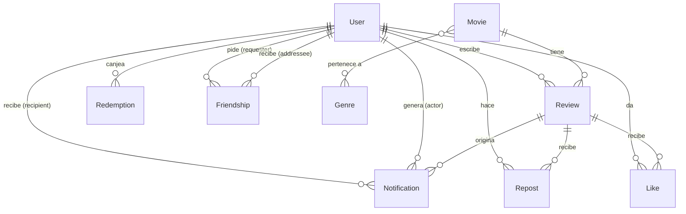

# Base de datos de WhatNext

Motor: **SQLite** embebido (archivo `prisma/dev.db`), manejado con **Prisma**.
Fuente de verdad: `prisma/schema.prisma`. Las tablas se crean con `npm run db:init` (`prisma db push`) y se llenan con `npm run db:seed`.
Para mirarlas: `npm run db:studio`.

> Estado: tablas de los **Sprints 1 a 6** en uso.
> Las tablas de mapas (Sprint 7) todavía no existen.

## Diagrama

## Tablas

### User — usuarios y sesión (Sprint 2)
| Columna | Tipo | Notas |
|---|---|---|
| id | Int, PK autoincremental | |
| name | String | 1 a 60 caracteres |
| email | String, **único** | se guarda en minúsculas |
| passwordHash | String | hash **bcrypt**; nunca se devuelve en la API |
| role | String, default `user` | `user`, `moderator` o `superadmin`; nunca viene del body del registro |
| createdAt | DateTime, default now | |

### Movie — catálogo (Sprint 3)
| Columna | Tipo | Notas |
|---|---|---|
| id | Int, PK (no autoincremental) | es el **id de TMDB**; las películas cargadas a mano usan ids desde 1.000.000.000 |
| title | String | |
| overview | String | sinopsis |
| releaseDate | String? | `AAAA-MM-DD` |
| runtime | Int? | minutos |
| posterPath | String? | path de TMDB (`/abc.jpg`) o URL completa si se cargó a mano |
| backdropPath | String? | idem |
| metadata | String, default `{}` | **JSON**: `actors`, `directors`, `crew`, `trailers`, `watchProviders` |
| featured | Boolean, default false | destacada en el Home |
| hidden | Boolean, default false | oculta del catálogo público |
| syncedAt | DateTime | última sincronización con TMDB |

Relación muchos a muchos con **Genre** (tabla intermedia `_GenreToMovie`, la crea Prisma).

### Genre — géneros (Sprint 3)
| Columna | Tipo | Notas |
|---|---|---|
| id | Int, PK | id de TMDB; los géneros creados a mano usan ids desde 100.000 |
| name | String | |

### Review — reseñas (Sprint 4)
| Columna | Tipo | Notas |
|---|---|---|
| id | Int, PK autoincremental | |
| text | String | 1 a 2000 caracteres |
| rating | Float | 0 a 5, de a media estrella |
| photo | String? | imagen `data:image/jpeg|png;base64,...`, hasta ~1 MB |
| createdAt / updatedAt | DateTime | `updatedAt` se informa como `null` si nunca se editó |
| authorId → User | Int, FK, **cascade** | si se borra el usuario, se borran sus reseñas |
| movieId → Movie | Int, FK, **cascade** | si se borra la película, se borran sus reseñas |

Restricción: **única (authorId, movieId)** → una reseña por usuario y película.
Índices: `(movieId, createdAt)` y `(authorId, createdAt)`.

### Like — me gusta (Sprint 4)
PK compuesta **(userId, reviewId)**, así no se puede dar dos veces. `createdAt`. FK a User y Review con cascade.

### Repost (Sprint 4)
PK compuesta **(userId, reviewId)**. `createdAt`. Índice `(userId, createdAt)`. FK con cascade.

### Redemption — canjes de premios (Sprint 5)
| Columna | Tipo | Notas |
|---|---|---|
| id | Int, PK autoincremental | |
| userId → User | Int, FK, cascade | |
| rewardId | String | id del premio (`popcorn`, `two_for_one`, `presale`, `free_ticket`); el catálogo vive en código (`services/gamification.ts`) |
| cost | Int | puntos al momento del canje (se guarda aunque el catálogo cambie) |
| code | String, **único** | 6 caracteres legibles, sin `0/O/1/I` |
| status | String, default `active` | `active`, `used`, `refunded` (`expired` se calcula, no se guarda) |
| createdAt, expiresAt | DateTime | vence a los 30 días |
| usedAt, refundedAt | DateTime? | |

Índice `(userId, status)`. Puntos gastados = suma de `cost` de los canjes que **no** están `refunded`.

### Friendship — amistades (Sprint 6)
| Columna | Tipo | Notas |
|---|---|---|
| id | Int, PK | |
| requesterId / addresseeId → User | Int, FK, cascade | quién pidió y quién recibió |
| userLowId / userHighId | Int | ids ordenados (menor, mayor) |
| status | String, default `pending` | `pending` o `accepted` |
| createdAt | DateTime | |

Restricción: **única (userLowId, userHighId)** → entre dos personas hay una sola relación, sin importar quién pidió.

### Notification — avisos (Sprint 4 los crea, Sprint 6 los lista)
| Columna | Tipo | Notas |
|---|---|---|
| id | Int, PK | |
| recipientId → User | Int, FK, cascade | a quién se avisa |
| actorId → User | Int, FK, cascade | quién hizo la acción |
| type | String | `review_like`, `review_repost`, `friend_request` (los que sabe mostrar la app) |
| reviewId → Review | Int?, FK, cascade | |
| friendshipId | Int? | |
| read | Boolean, default false | |
| createdAt | DateTime | |

Índice `(recipientId, read)`. No se avisa a uno mismo ni se duplican avisos iguales. `friendshipId` no es clave foránea: al cancelar una solicitud pendiente se borran sus avisos a mano; al aceptar o rechazar, el aviso queda como leído.

## Qué NO está en la base
- **Logros**: se calculan en cada consulta a partir de las reseñas (`services/gamification.ts`). Los puntos totales = suma de los logros desbloqueados.
- **Rangos** (Espectador, Cinéfilo, Crítico, Director): se calculan por cantidad de reseñas.
- **Catálogo de premios**: constante en código.

## Datos de prueba (seed)
`npm run db:seed` es idempotente (se puede correr varias veces):
- 5 usuarios demo, contraseña `Demo1234`: `admin.demo@whatsnext.app` (superadmin), `sofia.demo@whatsnext.app` (moderator), `mateo.demo@`, `lucia.demo@`, `nicolas.demo@` (user), todos `@whatsnext.app`.
- 13 películas traídas de TMDB (necesita `TMDB_KEY` y conexión).
- 39 reseñas, likes y 3 amistades aceptadas (Mateo–Lucía, Mateo–Nicolás, Sofía–Lucía).

## Pendiente (Sprint 7: mapas)
Se agregarán `Cinema` (nombre, dirección, latitud, longitud) y `FavoriteCinema` (usuario ↔ cine) para búsquedas por cercanía y favoritos.
