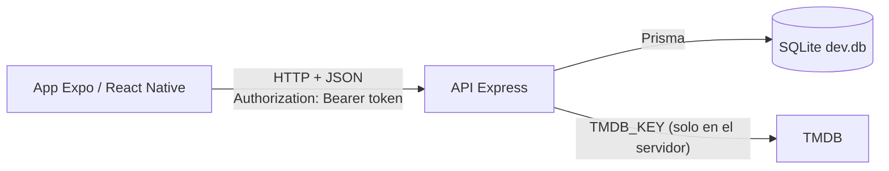
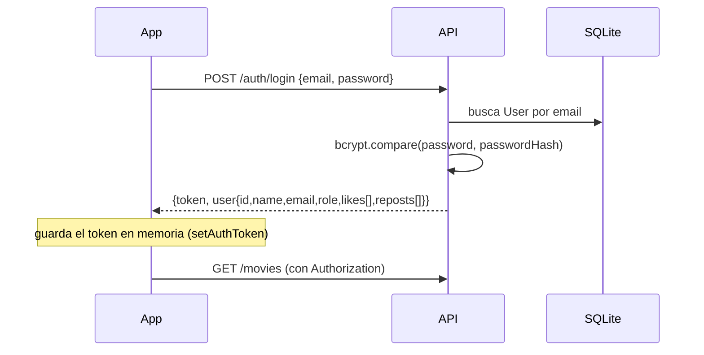
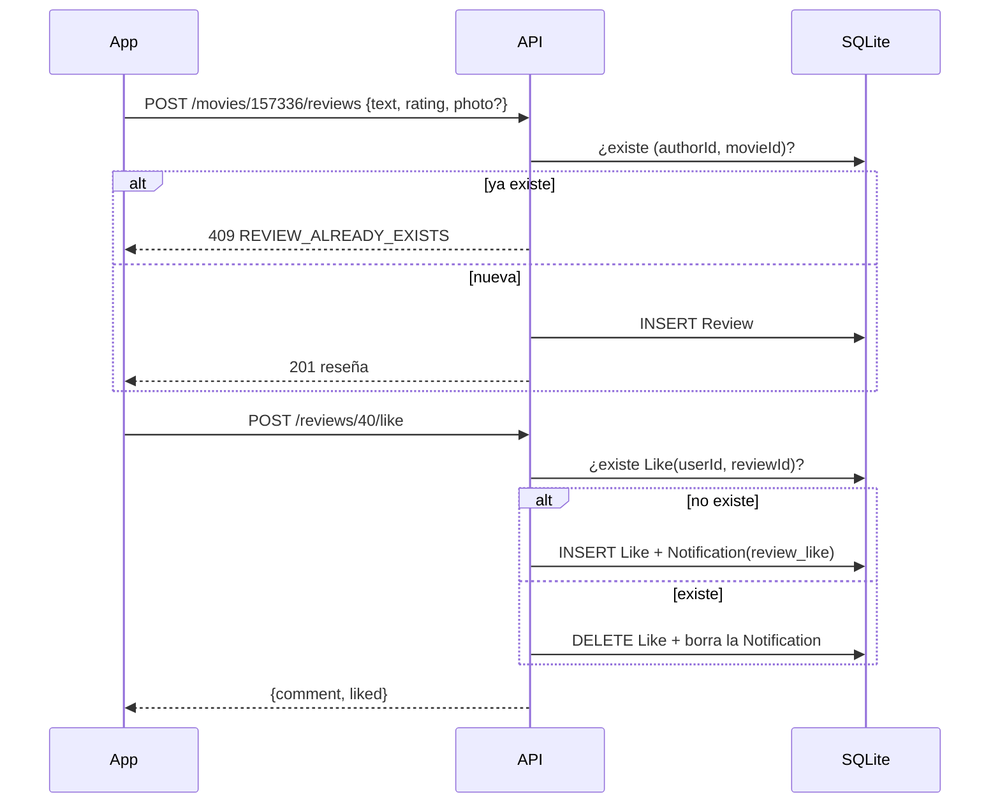
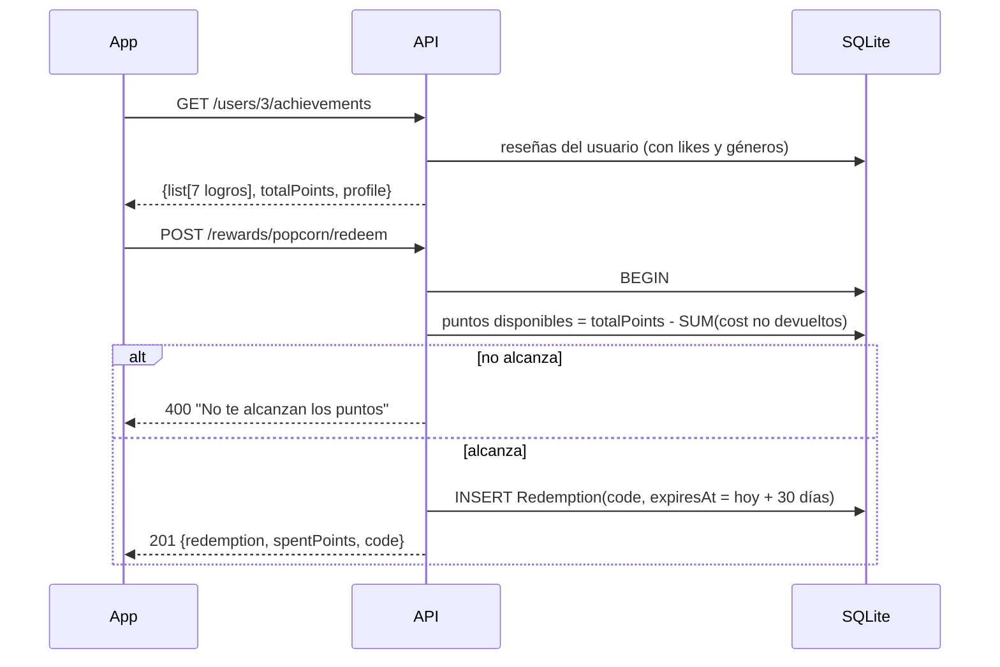
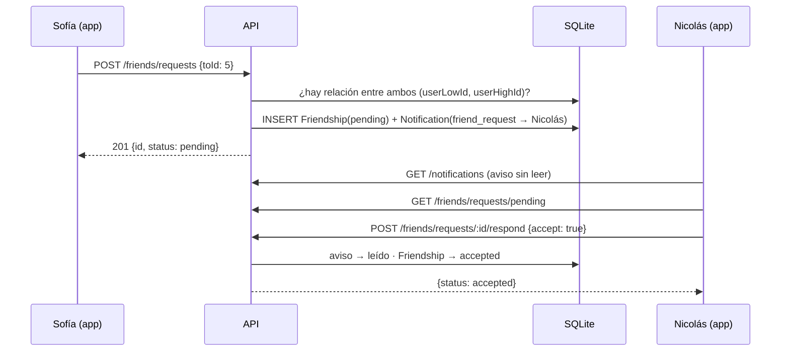

# Flujo de WhatNext: app, API y base de datos

## Arquitectura

- La app **nunca** habla con TMDB: el servidor guarda las películas en SQLite y reenvía cartelera y estrenos.
- Todo lo que la app pide pasa por `src/services/api.ts` (front), que agrega el token y traduce los errores.
- Capas del backend: `routes/` (HTTP y validación) → `services/` (lógica compartida) → `prisma` (consultas). `middlewares/auth.ts` protege las rutas.

## Convenciones de la API
- Base: `http://<servidor>:3000/api`. JSON en ambos sentidos.
- Sesión: `Authorization: Bearer <token>` (JWT de 7 días).
- Errores: `{ "error": "mensaje" }` y, en casos puntuales, `"code"` (por ejemplo `REVIEW_ALREADY_EXISTS`).
- Códigos: 400 datos inválidos · 401 sin sesión · 403 sin permiso · 404 no existe · 409 conflicto · 429 demasiados intentos · 503/502 TMDB.

## Flujo 1 — Registro e inicio de sesión (Sprint 2)

- Registro: valida nombre, email y contraseña (mín. 8, letra + número). El rol siempre queda `user`.
- Login: máximo 5 fallos por email+IP cada 15 minutos (después, 429).
- `likes` y `reposts` del usuario son listas de ids de reseñas; la app las usa para pintar los corazones.

## Flujo 2 — Catálogo (Sprint 3)
1. `npm run db:seed` (o `POST /movies/import/:tmdbId`) trae la película de TMDB (detalle + reparto + videos + dónde verla en Argentina) y la guarda en `Movie` / `Genre`.
2. La app pide `GET /movies` con filtros opcionales: `search`, `genre`, `year`, `featured`, `sort` (`rating` | `recent` | `title`), `limit`, `offset`.
3. Cada película llega con `commentsCount`, `reviewsLast30Days` y `communityRating`, calculados desde `Review`.
4. Solo un **superadmin** crea, edita o borra películas. Borrar una película borra sus reseñas.
5. Cartelera y próximos estrenos salen de `/releases/*` (caché de 10 minutos).

## Flujo 3 — Reseñas, likes y reposts (Sprint 4)

- Una reseña por usuario y película; solo el autor edita; el autor, un moderador o un superadmin borran.
- Like y repost son **interruptores**: la misma llamada pone o saca.
- Home: `GET /reviews/popular` (10 con más likes) y `GET /reviews/friends` (10 más recientes de mis amigos aceptados).

## Flujo 4 — Puntos, premios y perfil (Sprint 5)

- Los **logros** y los **rangos** se calculan al momento (no se guardan); los puntos son la suma de los logros desbloqueados.
- Canje: la verificación de puntos y el INSERT van en una **transacción**, para que dos canjes simultáneos no gasten puntos que no hay.
- Ciclo de vida de un canje: `active` → `used` (lo marca un moderador o superadmin en el cine) o `refunded` (lo devuelve un superadmin; recupera los puntos). Pasados 30 días un canje activo se informa como `expired`.
- Perfil público `GET /users/:id/profile`: reseñas, reposts, rango, y estadísticas (reseñas, reposts, likes recibidos, puntos, amigos).

## Flujo 5 — Amistades y notificaciones (Sprint 6)

Estados de la relación vistos desde quien consulta (`GET /friends/status/:userId`): `none` · `sent` (yo pedí) · `received` (me pidieron) · `friends`.

- Entre dos personas hay **una sola** relación, sin importar quién pidió (restricción única sobre los ids ordenados). Por eso pedir de nuevo, en cualquier sentido, da 409.
- Solo quien **recibió** puede aceptar o rechazar. Rechazar borra la solicitud.
- Cualquiera de los dos puede **eliminar** la amistad o cancelar una solicitud pendiente (si estaba pendiente, también se borra el aviso). Un tercero recibe 403.
- Notificaciones: las generan las solicitudes de amistad, los likes y los reposts (Flujo 3). Sacar el like o el repost borra el aviso. `GET /notifications` devuelve las últimas 100 con el actor y la película.
- El feed de amigos del Home (`GET /reviews/friends`) usa las amistades `accepted`.

## Endpoints (Sprints 1 a 6)

| Método y ruta | Quién | Para qué |
|---|---|---|
| GET `/health` | público | ver que el servidor vive |
| POST `/auth/register` · `/auth/login` | público | alta y sesión |
| GET `/auth/me` | sesión | usuario de la sesión |
| PATCH `/users/me` | sesión | cambiar nombre y/o email |
| GET `/movies` · `/movies/:id` · `/movies/:id/recommendations` · `/genres` | público | catálogo con filtros |
| POST · PATCH · DELETE `/movies` · `/movies/:id` | superadmin | administrar películas |
| POST `/movies/import/:tmdbId` | superadmin | importar desde TMDB |
| GET `/releases/now-playing` · `/releases/upcoming` | público | cartelera y estrenos |
| GET `/movies/:id/reviews` · `/users/:id/reviews` · `/users/:id/reposts` | público | reseñas |
| GET `/reviews/popular` | público | feed populares |
| GET `/reviews/friends` | sesión | feed de amigos |
| POST `/movies/:id/reviews` | sesión | publicar reseña |
| PATCH · DELETE `/reviews/:id` | autor (borrar: también moderador/superadmin) | editar / borrar |
| POST `/reviews/:id/like` · `/reviews/:id/repost` | sesión | interruptores |
| GET `/rewards` | público | catálogo de premios |
| GET `/users/:id/achievements` · `/users/:id/profile` | público | logros y perfil |
| GET `/rewards/redemptions` | sesión | mis canjes y puntos gastados |
| POST `/rewards/:rewardId/redeem` | sesión | canjear |
| POST `/redemptions/:id/use` | moderador/superadmin | marcar usado |
| POST `/redemptions/:id/refund` | superadmin | devolver puntos |
| GET `/friends` · `/friends/requests/pending` | sesión | mis amigos / solicitudes recibidas |
| GET `/friends/status/:userId` | sesión | relación conmigo: none, sent, received, friends |
| POST `/friends/requests` `{toId}` | sesión | mandar solicitud |
| POST `/friends/requests/:id/respond` `{accept}` | quien la recibió | aceptar o rechazar |
| DELETE `/friends/:requestId` | cualquiera de los dos | eliminar amigo / cancelar solicitud |
| GET `/notifications` | sesión | mis avisos |
| PATCH `/notifications/:id/read` · POST `/notifications/read-all` | sesión | marcar leídos |

## Cómo correr todo
1. **Backend** (`aplicaciones-moviles-2026-back`): `npm install` · copiar `.env.example` a `.env` y completar `JWT_SECRET` y `TMDB_KEY` · `npm run db:init` · `npm run db:seed` · `npm start`.
2. **Front** (`aplicaciones-moviles-2026-front`): `npx expo start --web` (la URL del servidor está en `EXPO_PUBLIC_API_URL`; en celular real, usar la IP de la PC).
3. **Pruebas rápidas** del backend (servidor corriendo): `bash test-auth.sh`, `test-movies.sh`, `test-reviews.sh`, `test-rewards.sh`, `test-social.sh`, cada una con la URL como parámetro.

## Qué del front ya usa la API y qué sigue en mock

| Pantalla / contexto | Estado |
|---|---|
| Login, registro, editar usuario | API |
| Home (películas, populares, amigos) | API |
| Detalle de película (reseñas, like, repost) | API |
| Logros y premios | API |
| Perfil: reseñas, reposts, rango, estadísticas | API |
| Perfil: amistades, solicitudes, notificaciones | API |
| Administrar usuarios y roles | **mock** (Sprint 8) |
| Cines cercanos | Overpass directo desde la app (Sprint 7) |
